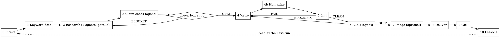

# Example Electric blog pipeline (v3)

Produces a verified, Portland/Vancouver-local, conversion-optimized post as two paste-ready files (`[slug]-post.html` for Divi, `[slug]-schema.txt` for WPCode), plus the Rank Math fields and a GBP companion. Nothing ships that is not traceable to a checked claim ledger. Architecture and the defect history that shaped it: `README-PIPELINE.md`.

**Core principle:** research produces a ledger, a second agent attacks the ledger, the post is written only from what survives, a script lints it, a humanizer strips the AI tells, a third agent audits it. The writer never verifies its own claims.

**Never work from memory of this file or its references.** A stale compaction copy once shipped an old phone number and a banned credential. Read them live, each time.

**Not this skill:** a GBP-only post (`example-electric-gbp-post`), branding a job photo (`example-electric-photo-brand`), logging retainer work (`example-electric-work-log`), a post for another client, or a code question with no deliverable.

## Paths and tool prefixes

| Name | Value |
|---|---|
| `SKILL_DIR` | the directory this SKILL.md was loaded from (currently `<skills folder>/example-electric-blog`; source mirror `~/clients/example-electric/outputs/blog-pipeline`) |
| `OUTPUTS` | `~/clients/example-electric/outputs` |
| Ahrefs MCP prefix | `mcp__<ahrefs-server-id>__` (the GSC-connected server; `plugin:marketing:ahrefs` is a different, unauthenticated connector, do not use it) |
| Higgsfield MCP prefix | `mcp__<image-server-id>__` |

`scripts/`, `reference/` and `agents/` are under `SKILL_DIR`; `outputs/` is under `OUTPUTS`. **Subagents start in a fresh working directory: replace every relative path in an agent prompt with the absolute one before dispatching.** `pbcopy` applies only when running interactively on Max's Mac. External dependencies: poppler (`pdftoppm`, `pdftotext`, `pdfinfo`), `curl` (one HTTPS GET to oregon.gov for the amendment table, cached 7 days), Chrome for the GBP card, the `content-humanizer` plugin for stage 4b.

## Reference files (read on demand)

| File | Read it when |
|---|---|
| `reference/company-and-rules.md` | Before writing. Company facts, hard bans, judgment rules, encoding, Divi. |
| `reference/research-standards.md` | Before research. Source tiers, Table 1-E rule, dated facts, data-window rule. |
| `reference/keyword-data.md` | Stage 1. Ahrefs calls, the export fallback, how to derive the research questions. |
| `reference/template.md` | While writing. CSS, inline SVG icon set, component snippets, schema template. |
| `reference/images.md` | Stage 7 and 9. Generated-image modes, alt text rules, GBP card. |
| `reference/seo-fields.md` | At delivery. Title/meta/excerpt rules, delivery table, WPCode settings, GBP checklist. |
| `OUTPUTS/blog-lessons.md` | Stage 0 of every run, and again whenever Max edits or corrects anything. His past edits, each with his reason. It lives outside `SKILL_DIR`, so a reinstall never wipes it. |
| `agents/*.md` | When dispatching that agent. Paste the file contents as the prompt with every `{{input}}` filled and every path absolute. |

## Pipeline



### 0. Intake
Establish topic (given, or "pick"), jurisdiction (Oregon / Washington / both), post type (cost guide, symptom guide, code explainer, comparison), and whether an image is wanted. A given topic still goes through stage 1 for the cannibalization check. Create `OUTPUTS/ledgers/<slug>/`. Read `OUTPUTS/blog-lessons.md` in full and say, one line each, which lessons apply to this post; those lines go to the writer in stage 4 and the auditor in stage 6.

### 1. Keyword and gap data
Follow `reference/keyword-data.md`: Ahrefs Pro calls on project <project-id>, or `scripts/gsc_gaps.py` on the latest export when a call returns `Insufficient plan`. Decide the topic on stated evidence (impressions, positions, existing coverage, window). Write the 6-10 questions the post must answer; they are the `{{questions}}` input for stage 2.

### 2. Research (two agents, parallel)
Dispatch two `general-purpose` agents in the same turn: `agents/researcher-code.md` -> `OUTPUTS/ledgers/<slug>/code.md`, `agents/researcher-local.md` -> `OUTPUTS/ledgers/<slug>/local.md`. Give each the topic, jurisdiction, questions, `SKILL_DIR`, the absolute output path, and the absolute path to `reference/research-standards.md`. They return only their summary line.

**What needs a ledger row:** any number, dollar figure, code section, fee, date, deadline, program status, or statement about what is required, permitted or prohibited. **What does not:** procedural how-to steps with no factual claim ("press TEST, then RESET"), definitions of common terms, the writer's own framing. Gemini Deep Research is an optional lead list if the user offers it, never a source.

### 3. Claim check (agent) and gate
Dispatch one `general-purpose` agent with `agents/claim-checker.md`, both ledger paths, jurisdiction, `SKILL_DIR`, and the absolute path for `OUTPUTS/ledgers/<slug>/checked.md`. It returns one merged table with one header. Then:
```bash
python3 SKILL_DIR/scripts/check_ledger.py OUTPUTS/ledgers/<slug>/checked.md
```
`BLOCKED` -> resolve the listed rows and re-run. `GATE OPEN` -> stage 4. The gate reads only the checker's `Check result` column; a researcher's own status never opens it. Keep the ESTIMATE and CONFIRMED-SECONDARY lists for the delivery.

### 4. Write
Read `reference/company-and-rules.md` and `reference/template.md`. Write from `checked.md` only: every factual sentence maps to a CONFIRMED, CONFIRMED-SECONDARY or CORRECTED row; ESTIMATE rows are introduced as planning numbers; DROPPED rows do not appear in any form. Structure in order: meta comment, style block, `.ea-post`, Last updated line, answer-first intro (never a question), hero stats, trust bar, TOC (over ~1,500 words), main table, question-form H2s answered in their first sentence, two inline CTAs, an Oregon-amendment callout wherever Oregon differs from the NEC (quoting only the underlined words), comparison cards where two options contrast, local section, figure only with a real URL, Sources, FAQ (5-7, first two open), final CTA. Schema per the template; FAQ text identical to the page; `dateModified` = Last updated; `areaServed` = jurisdiction. Apply every lesson stage 0 listed: a lesson shapes wording, structure and emphasis, never a fact.

### 4b. Humanize (visible)
Announce it: `Using skill: /content-humanizer (Mode 1 detect, Mode 2 humanize)`. Run it on the draft body with two constraints stated up front: **no factual sentence changes meaning, no number, code section, date or dollar figure moves**, and the voice blueprint is the tone line in `reference/company-and-rules.md` (expert, plain-spoken, direct, occasionally dry, never salesy), not a generic brand. Skip Mode 3 unless the user asks for voice work. Report the before/after humanity score; stage 5 prints it again from the plugin's scorer and warns under 80.

### 5. Lint
```bash
python3 SKILL_DIR/scripts/lint_post.py OUTPUTS/<slug>-post.html OUTPUTS/<slug>-schema.txt
```
Fix every FAIL and re-run until `CLEAN`. WARNs are judgment calls: resolve them or say why not.

### 6. Audit (agent)
Dispatch one `general-purpose` agent with `agents/auditor.md`, the two absolute file paths, `checked.md`, and `SKILL_DIR`. Append the stage 0 lesson lines to its prompt: a listed lesson the post ignores is a FIX. Apply every BLOCK and FIX using its replacement text, re-run stage 5. `DO NOT SHIP` returns to stage 4.

### 7. Image (only when asked)
Follow `reference/images.md`. Two modes on Higgsfield `nano_banana_pro`: `diagram` (ledger-confirmed labels) or `realistic` (no people, captioned as an illustration). **The stage is not done until the file, the alt text and the caption are all delivered together**; alt text is 8-16 words describing what is visible, names the image type when generated, carries no location tag and no claim the image cannot support.

### 8. Deliver
Print the full delivery table from `reference/seo-fields.md` (WP title first), the ledger counts, the ESTIMATE list, the CONFIRMED-SECONDARY list, the information gain, the humanizer score, and what changed versus the research. Say which keyword source stage 1 used and its window. List the lessons applied. `pbcopy` the post HTML; schema on request.

### 9. GBP companion
Always, immediately after delivery, per `reference/seo-fields.md` and `reference/images.md`, even after a long run. Default image is the branded card. Code claims on the card are checked against `checked.md` like body copy.

### 10. Lessons (any time Max corrects the work)
The pipeline learns from Max's edits. Whenever he edits a draft, rejects something, or asks for a change, at any stage or after delivery, append one entry to `OUTPUTS/blog-lessons.md` before the turn ends: the date, what he changed, why, and when it applies. Use his own words for the why. If he gave no reason, ask once in one line; if he does not answer, write the likeliest reason and mark it `inferred`. Then apply it to the work in hand. A lesson never overrides a ledger verdict, a gate, or a rule in `reference/company-and-rules.md`; if one seems to, say so and ask. When a lesson repeats, or a script could check it, propose a `lint_post.py` check and add it once Max agrees. A run with no edits from Max writes nothing.

## Quick reference

| Need | Command / file (absolute forms) |
|---|---|
| Pick a topic without Ahrefs | `python3 SKILL_DIR/scripts/gsc_gaps.py <export_dir> --existing-slugs <file>` |
| Read an Oregon amendment correctly | `bash SKILL_DIR/scripts/render_table1e.sh 680.42` then Read the PNG |
| Gate before writing | `python3 SKILL_DIR/scripts/check_ledger.py OUTPUTS/ledgers/<slug>/checked.md` |
| Pre-flight | `python3 SKILL_DIR/scripts/lint_post.py OUTPUTS/<slug>-post.html OUTPUTS/<slug>-schema.txt` |
| Humanize | `/content-humanizer` on the draft body, facts frozen |
| Agent prompts | `SKILL_DIR/agents/researcher-code.md`, `researcher-local.md`, `claim-checker.md`, `auditor.md` |
| Max's standing edits | `OUTPUTS/blog-lessons.md` (read at stage 0, appended at stage 10) |

## Red flags: stop and go back a stage

| Thought | Reality |
|---|---|
| "I already know this code section" | You know the NEC. You do not know what Oregon did to it this cycle. Render the page. |
| "The standards file says it is not adopted, so cite it" | Rows marked "text dump" there are leads. Render the page before the claim goes in. |
| "The number is close enough" | Close is a lawsuit. ESTIMATE it or drop it. |
| "The researcher cited it, that counts" | The checker exists because researchers misread. No verdict, no sentence. |
| "Everyone knows GFCIs have a TEST button, no row needed" | Correct, and that is the only kind of sentence that needs no row. The moment it says how far, how much, or whether it is required, it needs one. |
| "Lint is nitpicking" | Every lint check is a shipped mistake. |
| "It reads fine, skip the humanizer" | The scorer said 96 on a post that still had two clever-writer tics the client rejected. Run it and report the score. |
| "The audit found nothing" | Then it did not look. Ask it for the TOP RISK anyway. |
| "The image is done, alt text later" | The image is not done. Alt text ships with the file or the stage is open. |
| "The post shipped, the GBP can wait" | Stage 9 is the same run. A post with no GBP announcement is an unfinished run. |
| "The user is in a hurry, skip the checker" | The checker is the ten minutes that kept a wrong Oregon claim off the live site. Run it. |
| "I'll surface the WP title later" | It is in the delivery table. Print the table. |
| "That was a one-off preference" | He should not have to say it twice. Log it with his reason at stage 10. |
